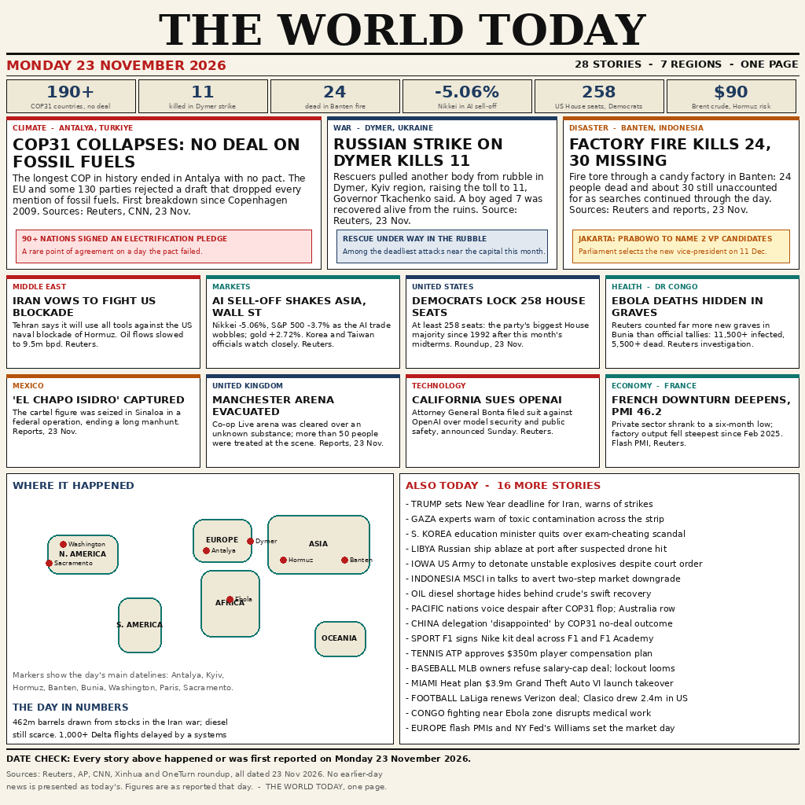
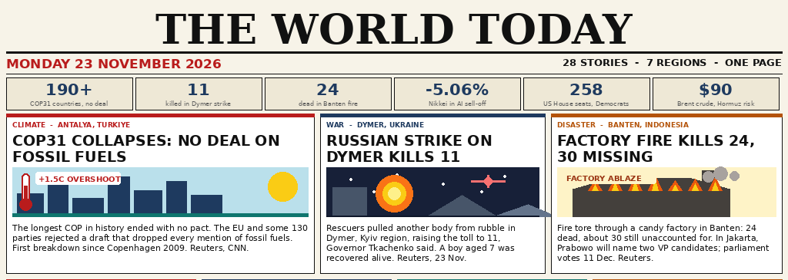
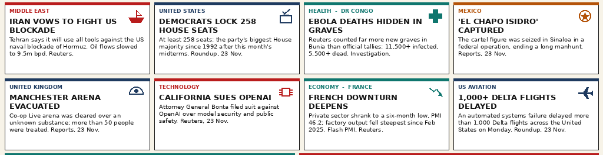
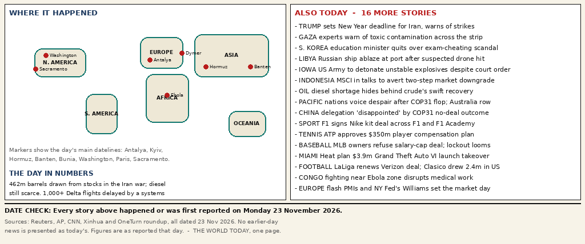

# The World Today: 23 November 2026 in One Image — 28 Stories, One Page

A dense one-page newspaper summing up Monday 23 November 2026: **28 verified stories across 7 regions**, drawn entirely with Pillow so every word renders crisply. Built for the make.fun bounty [news-image-20261123](https://make.fun/bounty/news-image-20261123).

## At a glance

| Section | Contents |
|---|---|
| Masthead | "THE WORLD TODAY — MONDAY 23 NOVEMBER 2026", 28 stories / 7 regions |
| Stat strip | 190+ COP31 countries · 11 Dymer dead · 24 Banten dead · Nikkei −5.06% · 258 US House seats · Brent $90 |
| Lead panels | COP31 collapses in Antalya · Russian strike on Dymer kills 11 · Banten factory fire kills 24 |
| Small panels (8) | Iran vs US blockade · AI sell-off · Democrats' 258 seats · Ebola hidden graves · El Chapo Isidro captured · Manchester arena evacuated · California sues OpenAI · France PMI 46.2 |
| Map | "WHERE IT HAPPENED" — schematic world map with the day's datelines marked |
| ALSO TODAY | 16 more one-line stories: Trump/Iran deadline, Gaza contamination, Korea exam scandal, Libya ship fire, Iowa explosives, MSCI–Indonesia, diesel shortage, Pacific despair, China reaction, F1–Nike, ATP $350m, MLB lockout, Miami–GTA VI, LaLiga–Verizon, Congo fighting, PMI day |
| Footer | DATE CHECK: every story happened or was first reported on 23 Nov 2026; sources Reuters, AP, CNN, Xinhua, OneTurn |

## Gallery

| Crop | What it shows |
|---|---|
|  | Masthead, stat strip and the three lead stories |
|  | The eight-panel grid: war, markets, health, crime, tech, economy |
|  | World map with markers, the day in numbers, and 16 more stories |

## Design notes

Breadth first, then craft: the winner pattern for this series is information density, so v2 packs a stat strip, three leads, eight small panels, a marked world map and a 16-line ALSO TODAY list onto one page — while the masthead and lead headlines stay readable at thumbnail size. The palette is four inks (black, red, navy, teal) plus a gold accent on a paper background. The generator was revised over several rounds to clear text overflow in the lead captions and footer before submission, and the final page was inspected at full size and at 25%.

## How it runs

`main.py` (Python 3.13, standard library only) copies `entry.png` to `$MAKEFUN_OUTPUT_DIR` (or `/output`). The image itself is produced by `generate_image.py` with Pillow: 1024×1024 PNG, 178,046 bytes, deterministic — two runs write identical bytes (sha256 `469de450…`).

## License

MIT — see `LICENSE`.

---
Entry for https://make.fun/bounty/news-image-20261123
